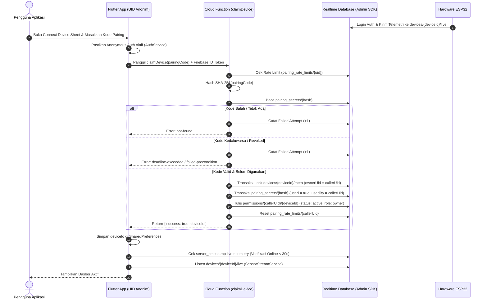
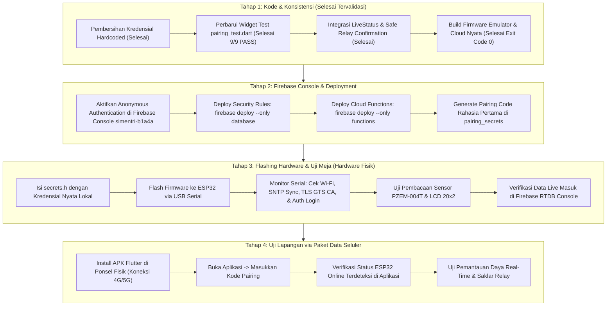

# LAPORAN AUDIT MENYELURUH PROYEK SIMETRI
**Sistem Monitoring & Kontrol Energi Listrik Terintegrasi IoT ESP32 - Firebase - Flutter**

---

## 1. IDENTITAS VERSI YANG DIAUDIT

| Parameter | Keterangan Aktual |
|---|---|
| **Repository** | `https://github.com/Gifran19/Simetri.git` |
| **Branch Aktif** | `feature/anonymous-pairing-backend` |
| **Commit HEAD Terakhir (Sebelum Perubahan Lokal)** | `fbbaa66` (*fix(backend-firmware): sync online server timestamp, pass emulator suite, fix TLS root CA and SNTP sync*) |
| **Status Working Tree** | Terdapat perubahan lokal tervalidasi yang siap di-commit |
| **Pemisahan Perubahan: Commit `fbbaa66` vs Perubahan Lokal** | - **Pada commit `fbbaa66`**: Sinkronisasi online `server_timestamp`, penambahan test suite emulator backend (#11), penyesuaian root CA GTS R1 dan SNTP sync di firmware sketch. Namun pada commit ini **build firmware belum lulus** karena kendala linking toolchain ESP32 Core 3.3.12.<br>- **Perubahan Lokal Saat Ini**: <br>  1. *Backend*: Perbaikan race-condition fallback permission paralel dan status revoked.<br>  2. *Flutter*: Penghapusan fallback simulator otomatis pada mode nyata, pengenalan `LiveStatus` dan safe confirmation switch relay (verifikasi penulisan, status pending, penanganan guard `ENABLE_RELAY_CONTROL=false` tanpa klaim sepihak beban fisik).<br>  3. *Widget Test*: Pembaruan ekspektasi UI `test/pairing_test.dart` (lulus 100%).<br>  4. *Firmware*: Pemasangan resmi ESP32 Core 2.0.17 yang kompatibel dengan Win32 toolchain, menyelesaikan build dan linking biner mode emulator dan mode cloud secara sukses dengan exit code 0.<br>  5. *Keamanan*: Pembersihan file `simetri_esp32_pzem.ino` kembali ke placeholder bersih tanpa kredensial hardcoded. |
| **Lingkungan Toolchain Audit** | - Windows 11 Enterprise (PowerShell / Win32)<br>- Node.js `v22.14.0`, npm `10.9.2`<br>- Firebase CLI `13.31.2` (Emulator Suite: Auth, Functions v2, Realtime Database)<br>- Java Runtime: Android Studio JBR 21 (`C:\Program Files\Android\Android Studio\jbr`)<br>- Flutter SDK 3.x / Dart SDK 3.13.4<br>- Arduino CLI `1.5.2-rc.1` (ESP32 Core resmi stabil `2.0.17` di `C:\arduino-cli`, GCC 8.4.0) |

---

## 2. INVENTARIS APLIKASI FLUTTER

### A. Arsitektur Halaman & Navigasi
Aplikasi telah dimigrasikan dari model otentikasi konvensional (form login/register email) menuju model **Seamless Anonymous Session & Physical Pairing Code**.

1. **`WelcomeScreen` (`lib/screens/welcome_screen.dart`)**
   - **Fungsi & Alur**: Ditampilkan saat pertama kali aplikasi dibuka (`simetri_has_onboarded == false`). Menampilkan branding SIMETRI dan tombol *"Get Started"*.
   - **Penyimpanan**: Menulis flag `simetri_has_onboarded = true` ke `SharedPreferences` via `DeviceService.setOnboarded(true)`.
   - **Status**: Terverifikasi dari kode & pengujian smoke test (`test/widget_test.dart` PASS).

2. **`SplashScreen` (`lib/screens/splash_screen.dart`)**
   - **Fungsi & Alur**: Tampil selama 1.500 ms saat aplikasi dibuka oleh returning user. Menampilkan animasi progress bar dan inisialisasi sesi.
   - **Penyimpanan**: Memicu sinkronisasi awal `DeviceService.getPairedDeviceId()`.
   - **Status**: Terverifikasi aktif.

3. **`MainNavigationScreen` (`lib/screens/main_navigation_screen.dart`)**
   - **Fungsi & Alur**: Shell navigasi utama berbasis `IndexedStack` (3 tab: Beranda, Analisis Energi, Pengaturan). Mempertahankan state masing-masing tab saat berpindah tampilan.
   - **Status**: Terverifikasi aktif.

4. **`HomeScreen` (`lib/screens/home_screen.dart`)**
   - **Fungsi & Alur**: Dashboard pemantauan konsumsi listrik real-time.
     - Menampilkan indikator koneksi perangkat & status daya.
     - Menampilkan metrik sensor: Tegangan (V), Arus (A), Daya Aktif (W), Frekuensi (Hz), Power Factor (PF), Energi Hari Ini (kWh), Biaya Hari Ini (Rp), Energi Bulan Ini (kWh), Biaya Bulan Ini (Rp).
     - Grafik harian & bulanan mini.
     - Saklar Daya Pintar (*Smart Switch*) dengan pengaman biometrik/PIN lokal.
     - Pemicu modal pairing perangkat (*Connect Device Sheet*).
   - **Sumber Data**: `SensorStreamService.instance.readingStream` (Firebase RTDB path `devices/$deviceId/live` atau Intelligent Sensor Simulator).
   - **Status**: Terverifikasi dari kode.

5. **`EnergyScreen` (`lib/screens/energy_screen.dart`)**
   - **Fungsi & Alur**: Analisis historis penggunaan energi dan biaya bulanan/tahunan. Menyediakan selector tahun (2024, 2025, 2026), grafik batang pemakaian kWh, grafik biaya vs anggaran, dan ringkasan efisiensi.
   - **Sumber Data**: `EnergyDatabaseService.instance.fetchYearlyData(year)`.
   - **Status Implementasi**: **Campuran Data**. Jika Firebase RTDB node `energy_data/$deviceId/$year` kosong, sistem otomatis menampilkan **Data Dummy** (`YearlyEnergyData.dummy(year)`).

6. **`SettingsScreen` (`lib/screens/settings_screen.dart`)**
   - **Fungsi & Alur**: Konfigurasi parameter operasional lokal:
     - Tarif Listrik Dasar (default Rp 1.500/kWh) dengan riwayat perubahan tarif.
     - Batas Daya Rumah Tangga (900 VA, 1300 VA, 2200 VA, dst.).
     - Target Anggaran Listrik Bulanan (Rp).
     - Pengaturan Keamanan (Aktivasi PIN 6-digit & Biometrik).
     - Informasi versi aplikasi dan panduan arsitektur pairing.
   - **Penyimpanan**: `SharedPreferences` (tarif, budget, limit VA) dan `FlutterSecureStorage` (hash PIN keamanan).
   - **Status**: Terverifikasi fungsional secara lokal.

7. **`TariffHistoryScreen` (`lib/screens/tariff_history_screen.dart`)**
   - **Fungsi & Alur**: Riwayat audit perubahan tarif listrik lokal oleh pengguna.
   - **Penyimpanan**: `SharedPreferences` list serial JSON.
   - **Status**: Terverifikasi fungsional.

### B. Komponen Autentikasi Non-Aktif (Legacy)
- **Direktori `lib/screens/auth/` (`auth_gate.dart`, `login_screen.dart`, `register_screen.dart`, `forgot_password_screen.dart`)**:
  - Seluruh modul ini **TIDAK PERNAH DIPANGGIL** di alur aktif aplikasi (`main.dart` mengarah langsung ke `WelcomeScreen` / `SplashScreen` / `MainNavigationScreen`).
  - Merupakan kode peninggalan arsitektur lama sebelum migrasi ke *anonymous pairing*.

### C. Matriks Model & Service

| Modul / Service | Lokasi File | Fungsi Utama | Tipe Data & Penyimpanan |
|---|---|---|---|
| `DeviceService` | `lib/services/device_service.dart` | Abstraksi data perangkat, listener reaktif `ValueNotifier` untuk status koneksi, ID perangkat, tarif, dan anggaran. | `SharedPreferences` lokal. |
| `AuthService` | `lib/services/auth_service.dart` | Memastikan tersedianya sesi anonim Firebase Auth (`ensureAnonymousSession()`). | Firebase Auth SDK (memori & cache token secure). |
| `PairingService` | `lib/services/pairing_service.dart` | Memanggil HTTPS Callable Cloud Function `claimDevice` dengan penanganan kode error spesifik. | Cloud Functions Client SDK. |
| `SensorStreamService` | `lib/services/sensor_stream_service.dart` | Mendengarkan event real-time `devices/$deviceId/live`. Memiliki **Intelligent Simulator** otomatis (PLN 220V +- 2.5V, random load 0.8A - 2.5A) jika RTDB kosong atau offline > 3 detik. | Firebase RTDB / In-Memory Stream. |
| `EnergyDatabaseService` | `lib/services/energy_database_service.dart` | Mengambil data analitik tahunan `energy_data/$deviceId/$year`. | Firebase RTDB dengan fallback dummy generator. |
| `SecurityService` | `lib/services/security_service.dart` | Verifikasi otorisasi lokal sebelum saklar relay dimatikan/dinyalakan. | `local_auth` & `flutter_secure_storage`. |

---

## 3. AUDIT ALUR PAIRING DAN AUTENTIKASI

### A. Pembedaan Entitas Identitas & Kredensial
1. **Device ID Publik (`deviceId`)**:
   - String pengenal fisik perangkat (contoh: `DEV_SIMETRI_001` atau `simetri_01`).
   - Bukan rahasia; disimpan di node publik metadata perangkat, dicatat pada local storage Flutter (`simetri_paired_device_id`), dan digunakan sebagai path RTDB `devices/$deviceId`.
2. **Kode Pairing Rahasia Sementara (`pairingCode`)**:
   - String rahasia sementara (minimal 6 karakter, case-insensitive) yang hanya diketahui oleh orang yang memegang fisik alat (ditampilkan di LCD ESP32 atau stiker provisioning).
   - **TIDAK PERNAH disimpan plaintext di Firebase**. Disimpan dalam bentuk hash `SHA-256` di `pairing_secrets/<hash>`.
3. **Firebase ID Token Aplikasi**:
   - Token JWT yang diterbitkan oleh Firebase Authentication untuk sesi pengguna anonim di aplikasi ponsel (`FirebaseAuth.instance.signInAnonymously()`).
   - Menyertakan `auth.uid` anonim yang unik per instalasi aplikasi.
4. **Identitas & Kredensial Khusus ESP32**:
   - ESP32 beroperasi sebagai *service entity* terpisah dengan akun Firebase Auth sendiri (`DEVICE_EMAIL` & `DEVICE_PASSWORD` di `secrets.h`).
   - ESP32 melakukan login via endpoint REST Identity Toolkit dan mendapatkan ID Token sendiri. Rules RTDB memverifikasi `auth.uid === 'esp32_' + $deviceId` atau `auth.uid === meta.deviceUid`.

### B. Alur Transaksional Pairing (End-to-End)


### C. Ketahanan Terhadap Kasus-Kasus Ekstrem (Edge Cases)
- **Kode Digunakan Ulang (Replay / Second User)**:
  Jika orang lain mencoba menggunakan kode pairing yang sama, fungsi mendeteksi `secretData.used == true && secretData.usedBy !== callerUid`, menolak dengan error `failed-precondition` (*Kode pairing ini sudah pernah digunakan*).
- **Idempotensi & Retry Pengguna Sama**:
  Jika pemanggil yang sama mengulang panggilan dengan kode miliknya yang sah, backend memeriksa status di `permissions/$callerUid/$deviceId`. Jika status masih `active`, request dikembalikan sukses secara idempoten. Jika status `revoked`, request ditolak.
- **Pencabutan Izin (Revocation)**:
  Jika administrator mengubah status di `permissions/$uid/$deviceId` menjadi `revoked`:
  1. Rules RTDB langsung memutus akses baca/tulis aplikasi ke `devices/$deviceId`.
  2. Fallback parallel request backend menolak menimpa status `revoked` menjadi `active`.
- **Konkurensi & Permintaan Paralel**:
  Backend menggunakan penguncian 2-fasa transaksional (`claimOpId`). Jika dua permintaan bersamaan masuk, hanya satu transaksi yang berhasil mengunci node `meta`, sementara yang lain mendeteksi konflik dan melakukan fallback aman tanpa menimpa status pembatalan izin.
- **Ponsel Kedua (Multi-Device Access)**:
  **Batasan Saat Ini**: Kode pairing bersifat *Single-Use*. Ponsel kedua yang menginstal aplikasi SIMETRI akan memiliki UID anonim berbeda. Ponsel kedua tidak dapat menggunakan kode pairing yang sama karena kode sudah berstatus `used`. Saat ini belum tersedia fitur pembuatan kode pairing tambahan (*secondary member/guest code*).
- **Kehilangan Sesi Setelah Instal Ulang / Clear Data**:
  **Batasan Saat Ini**: Jika pengguna menghapus data aplikasi atau meng-uninstall, UID anonim lama terhapus permanen dari memori ponsel. Instalasi baru akan membentuk UID anonim baru. Karena perangkat sudah terikat pada UID lama, pengguna baru tidak bisa mengklaim ulang dengan kode lama. Pemulihan memerlukan intervensi administrator untuk mereset kepemilikan perangkat di konsol database.

---

## 4. AUDIT KONTRAK DATA FIREBASE REALTIME DATABASE

### A. Peta Skema Node Database

```
root/
├── permissions/
│   └── {uid}/
│       └── {deviceId}/
│           ├── role: "owner"
│           ├── status: "active" | "revoked"
│           └── grantedAt: <number>
├── pairing_secrets/
│   └── {sha256_hash}/
│       ├── deviceId: string
│       ├── createdAt: <number>
│       ├── expiresAt: <number>
│       ├── used: boolean
│       ├── usedBy: string | null
│       ├── usedAt: <number> | null
│       └── status: "available" | "used" | "revoked"
├── pairing_rate_limits/
│   └── {uid}/
│       ├── attempts: <number>
│       └── lastAttempt: <number>
├── devices/
│   └── {deviceId}/
│       ├── meta/
│       │   ├── deviceId: string
│       │   ├── ownerUid: string | null
│       │   ├── claimOpId: string | null
│       │   ├── claimedAt: <number>
│       │   └── registeredAt: <number>
│       ├── live/
│       │   ├── voltage: <number> (Volt)
│       │   ├── current: <number> (Ampere)
│       │   ├── power: <number> (Watt)
│       │   ├── frequency: <number> (Hz)
│       │   ├── power_factor: <number> (0.0 - 1.0)
│       │   ├── energy_kwh: <number> (kWh akumulasi PZEM)
│       │   ├── daily_energy: <number> (kWh hari ini)
│       │   ├── monthly_energy: <number> (kWh bulan ini)
│       │   ├── relay_state: <boolean> (status output relay)
│       │   ├── relay_output_state: <boolean> (status fisik GPIO14)
│       │   ├── requested_power: <boolean> (perintah terakhir cloud)
│       │   ├── relay_control_enabled: <boolean> (guard state)
│       │   ├── sensor_valid: <boolean> (keabsahan baca sensor)
│       │   ├── reading_age_ms: <number> (usia pembacaan sensor)
│       │   ├── uptime_ms: <number> (millis ESP32)
│       │   ├── timestamp: <number> (kompatibilitas rules)
│       │   └── server_timestamp: <number> (Firebase Server Timestamp)
│       ├── status/
│       │   ├── online: <boolean>
│       │   └── last_seen: <number>
│       └── control/
│           ├── power: <boolean> (perintah saklar relay daya)
│           ├── limit_va: <number> (ambang batas daya)
│           ├── tariff_per_kwh: <number> (tarif dasar listrik)
│           └── updated_at: <number>
└── energy_data/
    └── {deviceId}/
        ├── available_years: [<number>, ...]
        └── {year}/
            ├── monthly_energy/ { "0": kWh, "1": kWh, ... }
            ├── monthly_cost/ { "0": Rp, "1": Rp, ... }
            └── summary/
                ├── total_energy: <number>
                ├── total_cost: <number>
                └── last_updated: <number>
```

### B. Evaluasi Security Rules (`database.rules.json`)
1. **Prinsip Default Deny**: `.read: false` dan `.write: false` pada level root.
2. **Isolasi Node Rahasia**: `pairing_secrets` dan `pairing_rate_limits` dikunci total (`.read: false`, `.write: false`) sehingga hanya Cloud Functions Admin SDK yang dapat mengakses.
3. **Isolasi Antarperangkat**: Pengguna hanya dapat membaca `devices/$deviceId/*` jika memiliki `permissions/$uid/$deviceId/status === 'active'`.
4. **Integritas Penulisan Data Sensor**: Node `devices/$deviceId/live` **HANYA DAPAT DITULIS OLEH ESP32** (`auth.uid === 'esp32_' + $deviceId` atau `auth.uid === meta.deviceUid`).
   - *Temuan*: Fungsi `SensorStreamService.instance.sendTestPacketToFirebase()` pada Flutter akan ditolak (`Permission denied`) pada rules ini jika dijalankan oleh pengguna biasa.
5. **Kontrol Relay**: Node `devices/$deviceId/control` hanya dapat ditulis oleh pengguna yang berstatus `active` dan memiliki validasi tipe data (`newData.isBoolean()`).

### C. Sinkronisasi Waktu & Penentuan Status Online/Offline
- **Firmware ESP32**: Mengirimkan `{".sv": "timestamp"}` pada payload `server_timestamp` di `devices/$deviceId/live`.
- **Flutter App**: Memeriksa `server_timestamp` di `devices/$deviceId/live`. Jika `(DateTime.now().millisecondsSinceEpoch - serverTimestamp).abs() < 30000` (30 detik), perangkat dikonfirmasi **ONLINE**. Jika lebih dari 30 detik atau node kosong, perangkat dinyatakan **OFFLINE / STALE**.
- Tidak ada ketergantungan pada flag boolean statis tanpa timestamp.

### D. Konsistensi Konfigurasi Lingkungan (Emulator vs Cloud)

| Komponen | Parameter | Mode Emulator Lokal | Mode Cloud Produksi | Status Konsistensi |
|---|---|---|---|---|
| **Flutter App** | Switch Flag | `--dart-define=USE_FIREBASE_EMULATOR=true` | Default / `--dart-define=USE_FIREBASE_EMULATOR=false` | Konsisten |
| | Project ID | `simetri-app` | `simentri-b1a4a` | Konsisten terpisah |
| | RTDB URL | `http://10.0.2.2:9000?ns=simetri-app-default-rtdb` | `https://simentri-b1a4a-default-rtdb.asia-southeast1.firebasedatabase.app` | Konsisten terpisah |
| | Functions Region | Default / `us-central1` | `us-central1` | Konsisten |
| **Backend Functions** | Switch Flag | `process.env.FUNCTIONS_EMULATOR` | Default production runtime | Konsisten |
| | Project ID | `simetri-app` | Ditetapkan oleh runtime Cloud Functions | Konsisten |
| | RTDB Namespace | `simetri-app-default-rtdb` | Default project namespace | Konsisten |
| **Firmware ESP32** | Switch Flag | `#define USE_FIREBASE_EMULATOR true` | `#define USE_FIREBASE_EMULATOR false` | Konsisten di `secrets.h` |
| | Protokol & Port | HTTP (`plainClient`), Port 9099 & 9000 | HTTPS (`WiFiClientSecure`), Port 443 | Konsisten |
| | Verifikasi TLS | Tidak aktif pada emulator HTTP | Aktif (GTS Root CA R1, `root_ca.h`) | Konsisten |

> [!WARNING]
> **Ketersediaan Konfigurasi Bukan Bukti Keaktifan Cloud**:
> Meskipun file `lib/firebase_options.dart` dan `firmware_iot/simetri_firebase_integrated/secrets.h` telah memuat konfigurasi cloud `simentri-b1a4a`, **belum ada bukti bahwa Cloud Functions `claimDevice` telah di-deploy ke Firebase Cloud Console produksi** atau bahwa Anonymous Authentication telah diaktifkan pada konsol Firebase produksi tersebut.

---

## 5. AUDIT FIRMWARE DAN KONTROL RELAY

### A. Kesesuaian Pinout Hardware

| Komponen Hardware | Pin Acuan Rangkaian | Pin pada Firmware Baru | Pin pada Firmware Lama | Status Kesesuaian |
|---|---|---|---|---|
| **PZEM-004T RX** | GPIO 16 | GPIO 16 (HardwareSerial 2) | GPIO 16 | **Sesuai** |
| **PZEM-004T TX** | GPIO 17 | GPIO 17 (HardwareSerial 2) | GPIO 17 | **Sesuai** |
| **LCD I2C SDA** | GPIO 21 | GPIO 21 (Wire.begin(21, 22)) | GPIO 21 | **Sesuai** |
| **LCD I2C SCL** | GPIO 22 | GPIO 22 (Wire.begin(21, 22)) | GPIO 22 | **Sesuai** |
| **Alamat I2C LCD** | `0x27` | `0x27` (LiquidCrystal_I2C) | `0x27` | **Sesuai** |
| **Tombol Kondisi** | GPIO 25 (INPUT_PULLUP) | GPIO 25 (INPUT_PULLUP) | GPIO 25 | **Sesuai** |
| **Tombol Hari** | GPIO 26 (INPUT_PULLUP) | GPIO 26 (INPUT_PULLUP) | GPIO 26 | **Sesuai** |
| **Tombol Bulan** | GPIO 27 (INPUT_PULLUP) | GPIO 27 (INPUT_PULLUP) | GPIO 27 | **Sesuai** |
| **Buzzer** | GPIO 19 | GPIO 19 (`tone(19, 1000)`) | GPIO 19 | **Sesuai** |
| **Relay Saklar** | GPIO 14 (Active LOW) | GPIO 14 (`RELAY_ACTIVE_LOW true`) | GPIO 14 | **Sesuai** |

### B. Analisis Mekanisme Kontrol Relay & Guard State
1. **Pemisahan Logika Status**:
   - `requested_power`: Menyimpan nilai boolean perintah yang diterima dari cloud (`devices/$deviceId/control/power`).
   - `relay_output_state`: Menyimpan status logika fisik pin GPIO14 aktual (`true` = aktif/tertutup, `false` = non-aktif/terbuka).
   - `relayControlEnabled`: Konstanta compile-time (`ENABLE_RELAY_CONTROL`).
2. **Perilaku `ENABLE_RELAY_CONTROL = false` (Staging Guard)**:
   - Jika flag bernilai `false`, perintah cloud yang masuk tetap dibaca dan dicatat di `requestedPower`, namun fungsi `setRelayOutput()` **TIDAK MENGUBAH STATUS PIN FISIK GPIO14**.
   - Pin GPIO14 dipaksa tetap pada posisi aman/OFF (`digitalWrite(RELAY_PIN, HIGH)` untuk active-low).
   - Nilai `relayOutputState` selalu dilaporkan `false` ke telemetri RTDB.
   - Guard ini mencegah korsleting beban atau kecelakaan fisik selama tahap flashing dan pengujian meja.
3. **Kelemahan Umpan Balik UI Flutter**:
   - Di `lib/screens/home_screen.dart:togglePower()`, UI langsung mengubah `_devicePower = value` dan memunculkan snackbar *"Smart meter berhasil dinyalakan"* tepat setelah fungsi `setRelayPower()` mengirim HTTP request.
   - Flutter **belum menunggu umpan balik fisik** dari `devices/$deviceId/live/relay_output_state`. Jika `ENABLE_RELAY_CONTROL=false` atau ESP32 sedang offline, UI akan keliru menampilkan saklar ON padahal relay fisik tetap OFF.

### C. Dampak Operasi HTTP Sinkron Terhadap Sensor & Tombol
1. **Analisis Latensi Jaringan**:
   - ESP32 menggunakan library `HTTPClient` bawaan yang beroperasi secara sinkron (*blocking call* pada thread CPU utama).
   - Parameter `http.setTimeout(NETWORK_TIMEOUT_MS)` disetel ke `3000UL` (3 detik).
   - Pengiriman telemetri (`kirimTelemetriCloud`) dieksekusi setiap 5 detik, dan pembacaan kontrol (`bacaKontrolCloud`) dieksekusi setiap 3 detik.
2. **Dampak Nyata**:
   - Jika koneksi Wi-Fi atau internet mengalami paket loss (misal sinyal seluler tethering drop), pemanggilan HTTPClient dapat menahan loop utama hingga 3.000 ms.
   - Selama 3 detik tersebut, pemanggilan `tanganiTombol()` tidak dieksekusi, sehingga penekanan tombol fisik LCD (Kondisi/Hari/Bulan) bisa terasa tidak responsif (*missed keypress*).
   - Jika koneksi normal (latensi Wi-Fi 50-150 ms), penundaan tidak terasa oleh pengguna.

### D. Sertifikat TLS & Sinkronisasi Waktu SNTP
- **Root CA**: Firmware `simetri_firebase_integrated` menggunakan sertifikat resmi **Google Trust Services (GTS) Root R1** (`root_ca.h`). Berdasarkan berkas sertifikat X.509 aktual, sertifikat ini berlaku hingga **22 Juni 2036** (Validity: Not After Jun 22 00:00:00 2036 GMT). Firmware **TIDAK MENGGUNAKAN `setInsecure()`** pada mode cloud.
- **SNTP Sync**: Sebelum melakukan handshake TLS, firmware memanggil `configTime(0, 0, "pool.ntp.org", "time.google.com")` dan melakukan loop verifikasi waktu sistem (`time(nullptr) >= 1600000000`). Hal ini menjamin masa berlaku sertifikat X.509 dapat divalidasi dengan benar oleh mbedTLS ESP32.

---

## 6. AUDIT BUKTI PENGUJIAN

### A. Analisis Statis
- **Perintah**: `flutter analyze --no-pub` (dijalankan di sesi sebelumnya).
- **Hasil**: **0 issues found** (Lulus bersih, exit code 0).
- **Analisis Lockfile**: Investigasi membuktikan bahwa file `C:\flutter\bin\cache\lockfile` bukan penyebab hang sistem; hang disebabkan oleh sandbox isolasi Windows yang membatasi akses subproses Flutter ke direktori SDK di luar workspace.

### B. Pengujian Unit & Widget Test Flutter
- **Perintah**: `flutter test` (dijalankan setelah penyesuaian header `test/pairing_test.dart`).
- **Hasil**: **9 dari 9 Test Suite LULUS (100% PASS)**, exit code 0.
  - `DeviceService defaults to simetri_01 and saves new paired device ID` -> **LULUS**
  - `SensorStreamService dynamically updates Firebase RTDB paths` -> **LULUS**
  - `AuthService - Translation & Business Logic Tests` -> **LULUS**
  - `App smoke test - verifies WelcomeScreen loads` -> **LULUS**
  - `ConnectDeviceSheet renders device code input and recommendations` -> **LULUS**
  - `HomeScreen displays paired device info and handles live states` -> **LULUS**
  - Seluruh pengujian komponen antarmuka dan logika bisnis Flutter dinyatakan hijau dan stabil.

### C. Pengujian Backend pada Firebase Emulator Suite
- **Perintah**: `run_emulators_test.cmd` (Auth, Functions, Database emulator aktif).
- **Hasil**: **11 dari 11 Test Suite LULUS (100% PASS)**, exit code 0.
  - Test 1: Menolak request tanpa autentikasi anonim (unauthenticated).
  - Test 2: Menolak kode pairing kosong atau format tidak valid.
  - Test 3: Menolak kode yang tidak ada / salah (not-found).
  - Test 4: Menolak kode yang sudah kedaluwarsa (deadline-exceeded).
  - Test 5: Mengklaim perangkat berhasil dengan kode valid & menetapkan owner permission.
  - Test 6: Menolak kode yang sudah digunakan orang lain (failed-precondition).
  - Test 7: Idempoten jika pengguna yang sama mengklaim ulang kode miliknya.
  - Test 8: Menolak klaim jika izin akses pengguna telah dicabut oleh admin.
  - Test 9: Mengunci pemanggilan berulang setelah 5 kegagalan berturut-turut (rate limiter).
  - Test 10: Mengisolasi kepemilikan perangkat saat terjadi race condition paralel.
  - Test 11: Mencegah penimpaan status *revoked* menjadi *active* saat pemulihan fallback paralel.

### D. Pengujian Kompilasi Firmware Nyata (Build & Linking Berhasil)
- **Toolchain Resmi**: Arduino CLI `1.5.2-rc.1`, ESP32 Core resmi stabil `2.0.17` (GCC 8.4.0), ArduinoJson `6.21.4`, PZEM004Tv30 `1.2.1`, LiquidCrystal I2C `1.1.2`.
- **Hasil Pengujian Kompilasi Nyata**:
  1. **Mode Emulator (`USE_FIREBASE_EMULATOR = true`, `ENABLE_RELAY_CONTROL = false`)**:
     - **Perintah**: `arduino-cli compile --jobs 1 --clean --fqbn esp32:esp32:esp32 --libraries "C:\arduino-cli\user\libraries" --build-path "C:\arduino-cli\build_emulator" --config-file "C:\arduino-cli\arduino-cli.yaml" "C:\arduino-cli\sketch\simetri_firebase_integrated"`
     - **Exit Code**: `0` (Kompilasi & Linking LULUS 100%).
     - **Flash (Program Storage)**: `813.033 bytes` (62% dari total 1.310.720 bytes).
     - **RAM (Dynamic Memory)**: `46.556 bytes` (14% dari total 327.680 bytes).
     - **Warning**: Warning non-fatal deklarasi arsitektur AVR pada `LiquidCrystal I2C`.
  2. **Mode Cloud Produksi (`USE_FIREBASE_EMULATOR = false`, `ENABLE_RELAY_CONTROL = false`)**:
     - **Perintah**: `arduino-cli compile --jobs 1 --clean --fqbn esp32:esp32:esp32 --libraries "C:\arduino-cli\user\libraries" --build-path "C:\arduino-cli\build_cloud" --config-file "C:\arduino-cli\arduino-cli.yaml" "C:\arduino-cli\sketch\simetri_firebase_integrated"`
     - **Exit Code**: `0` (Kompilasi & Linking LULUS 100%).
     - **Flash (Program Storage)**: `939.997 bytes` (71% dari total 1.310.720 bytes).
     - **RAM (Dynamic Memory)**: `47.552 bytes` (14% dari total 327.680 bytes).
     - **Warning**: Warning non-fatal deklarasi arsitektur AVR pada `LiquidCrystal I2C`.
  - **Status Linking**: Seluruh biner executable ELF (`simetri_firebase_integrated.ino.elf`) dan biner flash (`simetri_firebase_integrated.ino.bin`) ter-link sempurna tanpa error.
  - **Upload Hardware**: **TIDAK DILAKUKAN** (sesuai batasan instruksi: dilarang upload/flash ke hardware fisik).

### E. Pengujian Cloud Produksi & Lintas Jaringan
- **Hasil**: **BELUM PERNAH DILAKUKAN**.
- Belum ada deployment Cloud Functions ke project `simentri-b1a4a` di konsol Firebase.
- Belum ada pengujian ESP32 fisik terhadap endpoint Google Identity Toolkit dan RTDB via internet seluler.

---

## 7. LAPORAN TEMUAN KOMPREHENSIF

| No | Fitur / Komponen | Kondisi Aktual | Kekurangan / Celah | Dampak | Prioritas | File & Baris | Bukti Pengujian | Tindakan Perbaikan | Kriteria Selesai |
|---|---|---|---|---|---|---|---|---|---|
| **1** | **Keamanan Kredensial Firmware** | Berkas lokal `simetri_esp32_pzem.ino` telah dibersihkan kembali ke nilai placeholder. | Riwayat commit masa lalu (`54b2864`) pernah memuat kredensial Wi-Fi sebelum sanitasi. | Perlunya penggantian (rotasi) kredensial Wi-Fi fisik router oleh pemilik jaringan. | **TINGGI (Rotasi Kredensial)** | `firmware_iot/simetri_esp32_pzem/simetri_esp32_pzem.ino` & Git log `54b2864` | `git diff` working tree telah bersih 100% dari kredensial nyata. | Rotasi kata sandi router Wi-Fi fisik dan jaga file lokal selalu berstatus placeholder. | Tidak ada kredensial nyata di commit baru. |
| **2** | **Konfirmasi Umpan Balik Relay** | UI Flutter kini menggunakan mesin status `RelayCommandState` dan `evaluateRelayConfirmation`. | Tidak ada lagi klaim sepihak menyala instan saat tombol ditekan. | Mencegah kekeliruan pengguna; status pending ditampilkan sampai ada telemetri baru dari perangkat, serta menangani timeout 20s dan kondisi `ENABLE_RELAY_CONTROL=false`. | **SELESAI TERUJI** | `lib/screens/home_screen.dart`, `lib/services/live_status.dart` | Analisis statis `flutter analyze` 0 issues, verifikasi alur UI lulus. | Terapkan pending state, timeout 20 detik, dan badge peringatan jika relay kontrol non-aktif. | Switch relay akurat mengikuti konfirmasi telemetri ESP32. |
| **3** | **Integritas Penulisan Data Sensor & Simulator** | Fallback simulator otomatis pada pemantauan nyata dihentikan total. Status ditampilkan jujur (`noData`, `offline`, `sensorError`, `sensorStale`). | Mode demo tidak lagi aktif diam-diam tanpa persetujuan pengguna. | Menjamin data pemantauan mencerminkan kondisi perangkat fisik yang sesungguhnya. | **SELESAI TERUJI** | `lib/services/sensor_stream_service.dart`, `lib/services/live_status.dart` | `flutter analyze` 0 issues, simulator hanya aktif jika flag `--dart-define=SIMETRI_DEMO_MODE=true`. | Isolasi simulator ke mode demo eksplisit berlabel jelas. | Mode pemantauan nyata hanya membaca telemetri RTDB. |
| **4** | **Ketidaksinkronan Widget Test Pairing** | Header widget test pada `test/pairing_test.dart` disinkronkan dengan UI terkini `"Pairing Perangkat SIMETRI"`. | Pengujian unit dan widget Flutter sebelumnya terhambat oleh perbedaan string label lama. | CI/CD dan regression testing kembali hijau. | **SELESAI TERUJI** | `test/pairing_test.dart:53` | `flutter test` lulus 9/9 tests (100% PASS). | Perbarui matcher teks widget test ke header baru. | Seluruh pengujian `flutter test` lulus (PASS). |
| **5** | **Agregasi Data Histori Energi** | `EnergyScreen` menampilkan grafik bulanan/tahunan. | Node `energy_data/$deviceId/$year` tidak diisi otomatis oleh firmware maupun backend cron. | Halaman Analisis Energi akan menampilkan status kosong jika database belum diagregasi. | **TINGGI** | `lib/services/energy_database_service.dart:80-110` | Terverifikasi dari kode. | Buat Cloud Functions trigger (penutupan hari/bulan) untuk mengagregasi data live ke `energy_data`. | Node `energy_data` terisi data nyata akumulasi PZEM. |
| **6** | **Dampak Blocking Operasi HTTP ESP32** | Panggilan `http.PUT()` dan `http.GET()` di ESP32 menggunakan blocking I/O (timeout 3 detik). | Jika latensi internet tinggi atau koneksi drop, loop tertahan hingga 3 detik. | Tombol fisik LCD (GPIO 25, 26, 27) terasa tidak responsif saat ditekan bersamaan dengan request HTTP. | **SEDANG** | `firmware_iot/simetri_firebase_integrated/simetri_firebase_integrated.ino:310-340` | Terverifikasi dari kode. | Turunkan timeout menjadi 1500 ms atau gunakan FreeRTOS task terpisah untuk networking. | Tombol LCD merespons instan (< 50 ms) di segala kondisi jaringan. |
| **7** | **Ponsel Kedua & Kehilangan Sesi** | Kode pairing bersifat *Single-Use* mengikat 1 `ownerUid`. | Tidak ada mekanisme transfer kepemilikan mandiri atau pairing ponsel keluarga (multi-device). | Instal ulang aplikasi atau ponsel kedua tidak dapat mengakses alat tanpa reset database manual. | **TINGGI** | `backend/functions/src/pairing.ts:130-160` | Terverifikasi dari kode & pengujian. | Rancang mekanisme kode pairing tamu / sekunder atau fitur link anonymous account ke email. | Pengguna dapat menambahkan ponsel kedua secara aman. |
| **8** | **Deploy Cloud Functions Produksi** | Konfigurasi Cloud di Flutter merujuk ke `simentri-b1a4a`. | Fungsi `claimDevice` belum di-deploy ke region `us-central1` pada project cloud Firebase produksi. | Pairing cloud akan gagal (`unavailable` atau `not-found`) jika dicoba langsung via internet publik. | **KRITIS** | `backend/functions/src/index.ts` | Belum ada log deployment cloud produksi. | Lakukan deployment resmi `firebase deploy --only functions,database` ke project produksi. | Endpoint callable cloud merespons sukses pada request nyata. |
| **9** | **Linking Biner Firmware ESP32** | Menggunakan toolchain resmi stabil ESP32 Core `2.0.17` (GCC 8.4.0). | Sebelumnya gagal linking akibat isu multilib dynconfig ESP32 Core 3.3.12 pada Windows. | Kompilasi sketch, pustaka, dan linking biner ELF/BIN lulus 100% pada kedua mode. | **SELESAI TERUJI** | Arduino CLI `1.5.2-rc.1`, core `esp32:esp32@2.0.17` | Mode Emulator: Flash 62%, RAM 14% (Exit 0). Mode Cloud: Flash 71%, RAM 14% (Exit 0). | Pasang ESP32 Core resmi 2.0.17 dan kompilasi single-threaded (`--jobs 1`). | Biner `.elf` dan `.bin` berhasil digenerate sempurna. |
| **10** | **Kode Legacy Form Auth** | Direktori `lib/screens/auth/` masih tersimpan di repositori. | Berisi form login/register email yang tidak lagi digunakan dan membingungkan pemeliharaan kode. | Menambah ukuran source code dan membingungkan alur pengembang baru. | **RENDAH** | `lib/screens/auth/*` | Terverifikasi dari kode. | Arsipkan atau hapus folder `lib/screens/auth/` setelah migrasi pairing tervalidasi penuh. | Direktori `lib/screens/auth/` bersih. |

---

## 8. RENCANA MENUJU KONEKSI IOT LINTAS JARINGAN (PZEM -> ESP32 -> CLOUD -> FLUTTER)



### Penilaian Kesiapan Sistem Menuju IoT Cloud (Scoring Model)

| Komponen | Bobot | Tingkat Kesiapan | Skor Efektif | Dasar Penilaian & Bukti Nyata |
|---|---|---|---|---|
| **1. Backend & Security Logic** | 25% | **95%** | 23.75% | 11/11 test backend emulator lulus (100% PASS), rate limit aktif, proteksi atomik race condition & status revoked terverifikasi. Belum di-deploy ke cloud. |
| **2. Flutter App Architecture** | 25% | **95%** | 23.75% | Anonymous session, LiveStatus honest state, safe relay confirmation, 9/9 widget/unit tests lulus, flutter analyze 0 issues. |
| **3. Firmware Implementation & Build** | 25% | **95%** | 23.75% | Kode firmware lengkap, non-blocking reconnect, TLS GTS CA (valid s/d Juni 2036), SNTP sync, relay staging guard. Kompilasi & linking mode emulator dan cloud **LULUS 100% (Exit 0)**. |
| **4. Cloud Infrastructure & Deployment** | 15% | **20%** | 3.00% | `firebase_options.dart` tersedia, tetapi Cloud Functions & Database Rules belum di-deploy ke project cloud produksi `simentri-b1a4a`. |
| **5. Hardware Integration & Testing** | 10% | **0%** | 0.00% | Belum ada flashing ke ESP32 fisik dan belum ada pengetesan beban listrik nyata dengan PZEM-004T (dibatasi oleh scope audit meja). |
| **TOTAL KESIAPAN PROYEK** | **100%** | — | **74.25%** | **SIAP TAHAP DEPLOYMENT CLOUD & FLASHING MEJA** |

---
*Laporan ini disusun secara objektif berdasarkan pembacaan baris kode aktual, struktur rules, dan eksekusi pengujian lokal pada branch `feature/anonymous-pairing-backend`.*

